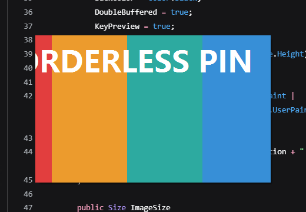

# SnapMove — 截图之后，把图钉在屏幕上拖着走

一个 Windows 小工具：按热键框选截图，截完立刻生成一个**无边框、置顶**的贴图窗口，按住图片任意位置就能拖着移动。

不用安装，单个 `SnapMove.exe`，依赖系统自带的 .NET Framework 4.0+。



## 开始用

1. 双击 `SnapMove.exe`。启动后不会弹窗，只在右下角托盘里留一个图标。
2. 按热键 **Ctrl + Shift + A**（如果 Ctrl+Alt+A 没被别的程序占用，会用 Ctrl+Alt+A），或者双击托盘图标。
3. 屏幕冻结变暗，按住鼠标左键拖出选区；松开后贴图出现在原来的位置，边缘会闪一下蓝色高亮。
4. 在图片上**按住左键拖动**即可移动；图片会自动复制到剪贴板。

热键被占用时会自动换一个：`Ctrl+Alt+A → Ctrl+Shift+A → Ctrl+Alt+S → Ctrl+Shift+S → Ctrl+Alt+X`。当前用哪个，托盘图标的提示文字里会写。

## 贴图上的操作

| 操作 | 效果 |
| --- | --- |
| 左键拖动 | 移动图片 |
| Ctrl + 滚轮 | 放大 / 缩小（10% – 400%） |
| Esc | 关闭这张贴图 |
| Ctrl + C 或双击 | 复制到剪贴板 |
| Ctrl + S | 另存为 |
| 右键 | 复制、另存、保存到截图文件夹、原始大小、缩放、始终置顶、关闭 |

## 其他

- 框选时按 **Esc 或点右键**取消，不会生成贴图。
- 托盘菜单：截图、开机自动启动、打开截图保存文件夹、使用说明、退出。
- 默认保存目录：`图片\SnapMove`，文件名 `Snap_年月日_时分秒.png`。
- 支持多显示器和高 DPI 缩放；坐标按物理像素处理，贴图和截图 1:1。
- 再启动一次 `SnapMove.exe` 不会开第二个托盘，只会让已经在跑的那个开始截图。
- 日志：`%TEMP%\SnapMove\snapmove.log`，出问题先看它。

## 自己构建

需要 Windows 自带的 .NET Framework 4.x（`csc.exe`）。

```
build.bat
```

或者手动：

```
%WINDIR%\Microsoft.NET\Framework64\v4.0.30319\csc.exe /nologo /target:winexe ^
  /platform:anycpu /optimize+ /codepage:65001 /out:SnapMove.exe ^
  /r:System.dll /r:System.Drawing.dll /r:System.Windows.Forms.dll src\*.cs
```

源码在 `src\`，纯 WinForms + P/Invoke，没有第三方依赖。中文界面，源码必须用 UTF-8 保存并带 `/codepage:65001` 编译。

## 自测

```
SnapMove.exe --selftest
type selftest.log
```

会驱动一张贴在屏幕上的测试窗口，验证截图尺寸/位置、拖动位移、缩放、Esc 关闭和右键取消，最后输出 `RESULT: PASS`。

外部端到端测试（会短暂占用桌面、移动鼠标，跑完自动清理）：

```
powershell -ExecutionPolicy Bypass -File test\E2E.ps1
```
